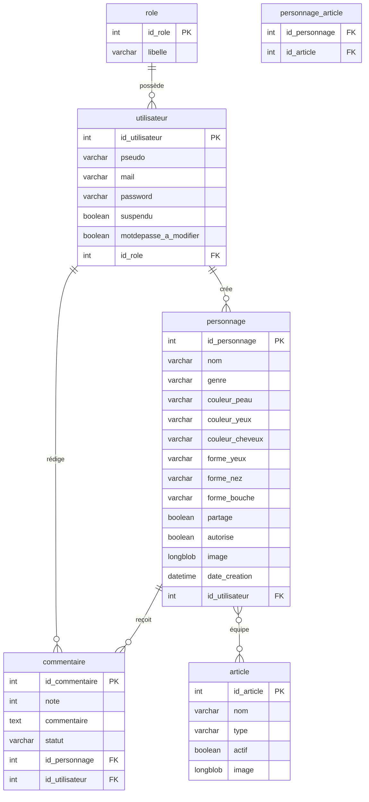
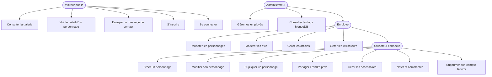
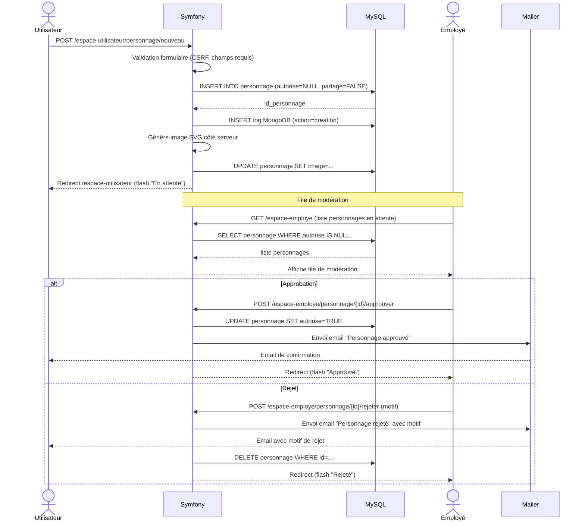
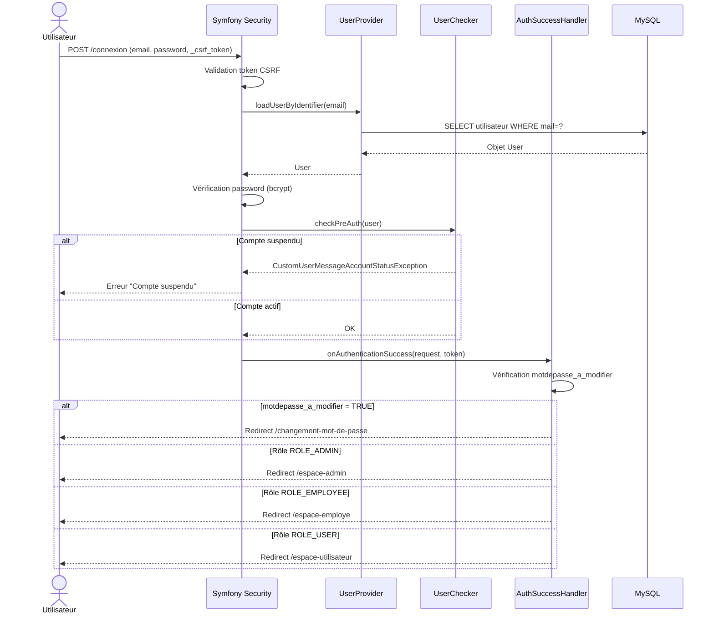

# Documentation technique — FantasyRealm Online

**Projet :** FantasyRealm Online — Application de gestion de personnages MMORPG
**Client :** PixelVerse Studios
**Version :** 1.0 — ECF Studi 2026

---

## 1. Réflexions technologiques initiales

### Choix du framework backend : Symfony 8 / PHP 8.4

Symfony a été retenu pour sa robustesse sur les applications métier complexes :
- **Sécurité intégrée** : CSRF, hachage de mots de passe (bcrypt), firewall configurable, hiérarchie de rôles
- **ORM Doctrine** : mapping objet-relationnel évitant le SQL manuel tout en permettant des requêtes optimisées
- **Système de templates Twig** : séparation claire logique / présentation
- **Mailer intégré** : gestion unifiée des emails (SMTP, null transport pour les tests)
- **Asset Mapper** : gestion des assets sans Node.js ni Webpack

### Choix de la base de données relationnelle : MySQL 8

MySQL a été préféré pour :
- **Données structurées** : entités fortement typées (utilisateurs, personnages, articles, commentaires)
- **Intégrité référentielle** : clés étrangères, contraintes CASCADE pour la suppression en cascade
- **Contraintes CHECK** : validation des valeurs de type "enum" directement en base

### Choix de la base NoSQL : MongoDB

MongoDB a été utilisé exclusivement pour les **logs d'activité** :
- Schéma flexible adapté aux événements hétérogènes
- Performances en écriture optimisées pour les logs
- Filtrage et pagination natifs
- Connexion via le driver PHP natif `ext-mongodb` + bibliothèque `mongodb/mongodb ^2.2`

### Choix de la conteneurisation : Docker + Docker Compose

- **Isolation** : chaque service dans son conteneur (PHP-FPM, Nginx, MySQL, MongoDB, Mailpit)
- **Reproductibilité** : même environnement en dev et en prod
- **Simplification du déploiement** : `docker compose up -d --build`

### Choix du frontend : Bootstrap 5 + JavaScript vanilla + Stimulus/Turbo

- **Bootstrap 5.3** via CDN : composants UI responsifs, thème dark natif
- **JavaScript vanilla** : validation formulaires, aperçu personnage canvas, étoiles interactives
- **Stimulus 3.2 + Turbo 7.3** : navigation SPA légère sans rechargement complet

---

## 2. Configuration de l'environnement

### Environnement de développement local (XAMPP)

| Service | Version | URL/Port |
|---|---|---|
| PHP | 8.4 | Ligne de commande |
| MySQL | 8.0 | localhost:3306 |
| Application | Symfony CLI | http://localhost |

Configuration : fichier `.env` (committé, valeurs dev par défaut)

### Environnement de développement Docker

```
docker-compose up -d --build
```

| Service | Image | Port hôte |
|---|---|---|
| Application | PHP 8.4-FPM + Nginx | http://localhost:8090 |
| MySQL | mysql:8.0 | localhost:3308 |
| MongoDB | mongo:latest | localhost:27019 |
| Mailpit (emails test) | axllent/mailpit | http://localhost:8026 |

Configuration : `.env` (base) + `.env.local` (surcharges Docker, non committé)

### Environnement de production

```
docker compose -f docker-compose.prod.yml --env-file .env.prod up -d --build
```

Différences par rapport au dev :
- Code source **copié dans l'image** (pas de volume de code)
- `APP_ENV=prod` → cache compilé, logs réduits
- MongoDB avec **authentification obligatoire**
- Ports MySQL/MongoDB **non exposés** à l'extérieur
- HTTPS via Let's Encrypt (Certbot)
- Assets compilés automatiquement via entrypoint.sh

---

## 3. Modèle Conceptuel de Données (MCD)



### Contraintes notables

- `utilisateur.suspendu` : booléen — compte bloqué si `TRUE`
- `utilisateur.motdepasse_a_modifier` : force le changement au prochain login
- `personnage.autorise` : tri-état — `NULL` = en attente, `TRUE` = approuvé, `FALSE` = rejeté (supprimé)
- `personnage.partage` : `TRUE` = visible dans la galerie publique
- `commentaire.statut` : `en_attente` | `approuve` | `refuse` (CHECK en base)
- `article.type` : `vetement` | `armure` | `accessoire` | `arme` (CHECK en base)
- `personnage.genre` : `Masculin` | `Féminin` | `Autre` (CHECK en base)

---

## 4. Diagramme de cas d'utilisation



---

## 5. Diagramme de séquence — Création et validation d'un personnage



---

## 6. Diagramme de séquence — Connexion et redirection selon le rôle



---

## 7. Architecture des services

| Service | Fichier | Responsabilité |
|---|---|---|
| `MailService` | `src/Service/MailService.php` | 5 types d'emails : contact, mot de passe oublié, personnage approuvé/rejeté, avis approuvé |
| `MongoLogService` | `src/Service/MongoLogService.php` | Écriture et lecture des logs dans MongoDB |
| `SvgPersonnageRenderer` | `src/Service/SvgPersonnageRenderer.php` | Génération SVG côté serveur (miroir PHP de `PersonnageRenderer.js`) |
| `PersonnageImageGenerator` | `src/Service/PersonnageImageGenerator.php` | Fallback GD pour la génération d'images PNG |

### Composants de sécurité

| Composant | Fichier | Rôle |
|---|---|---|
| `UserProvider` | `src/Security/UserProvider.php` | Chargement utilisateur depuis MySQL (colonnes françaises) |
| `UserChecker` | `src/Security/UserChecker.php` | Vérification suspension avant connexion |
| `AuthenticationSuccessHandler` | `src/Security/AuthenticationSuccessHandler.php` | Redirection post-login selon rôle + mot de passe à modifier |

---

## 8. Déploiement

Voir le fichier **`README.md`** à la racine pour les instructions complètes de déploiement local et production.

Fichiers de configuration clés :
- `docker-compose.yml` — Environnement de développement
- `docker-compose.prod.yml` — Environnement de production
- `docker/php/Dockerfile` — Image PHP 8.4-FPM avec extensions
- `docker/php/entrypoint.sh` — Script de démarrage (copie assets, génère images)
- `docker/nginx/default.conf` — Nginx développement
- `docker/nginx/prod.conf` — Nginx production (HTTPS, TLS 1.2/1.3)
- `database/01-schema.sql` — Schéma complet de la base de données
- `database/02-data.sql` — Données initiales (rôles, comptes, articles)
