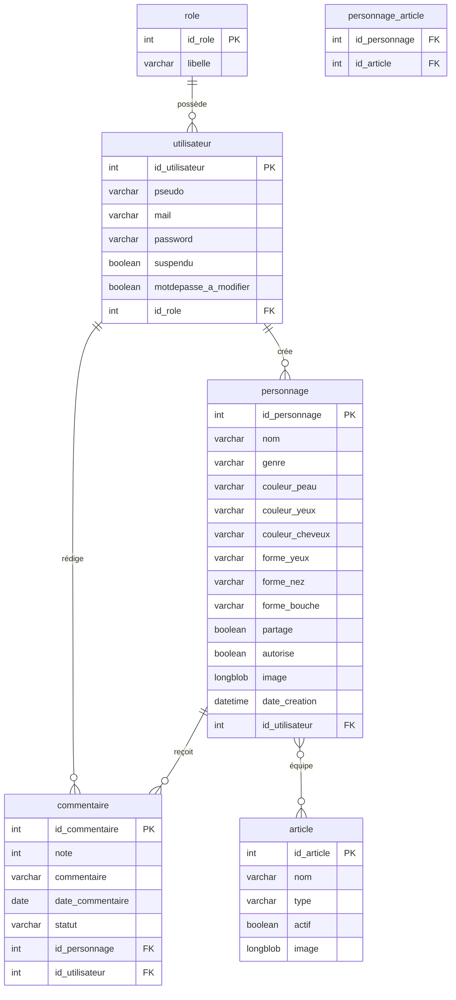
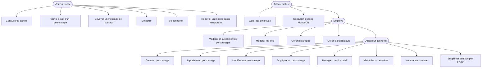
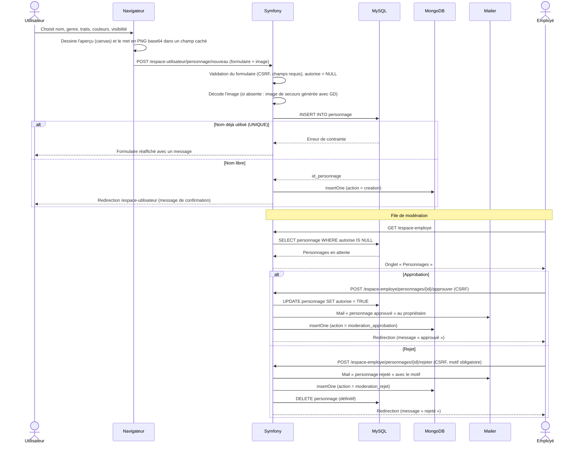
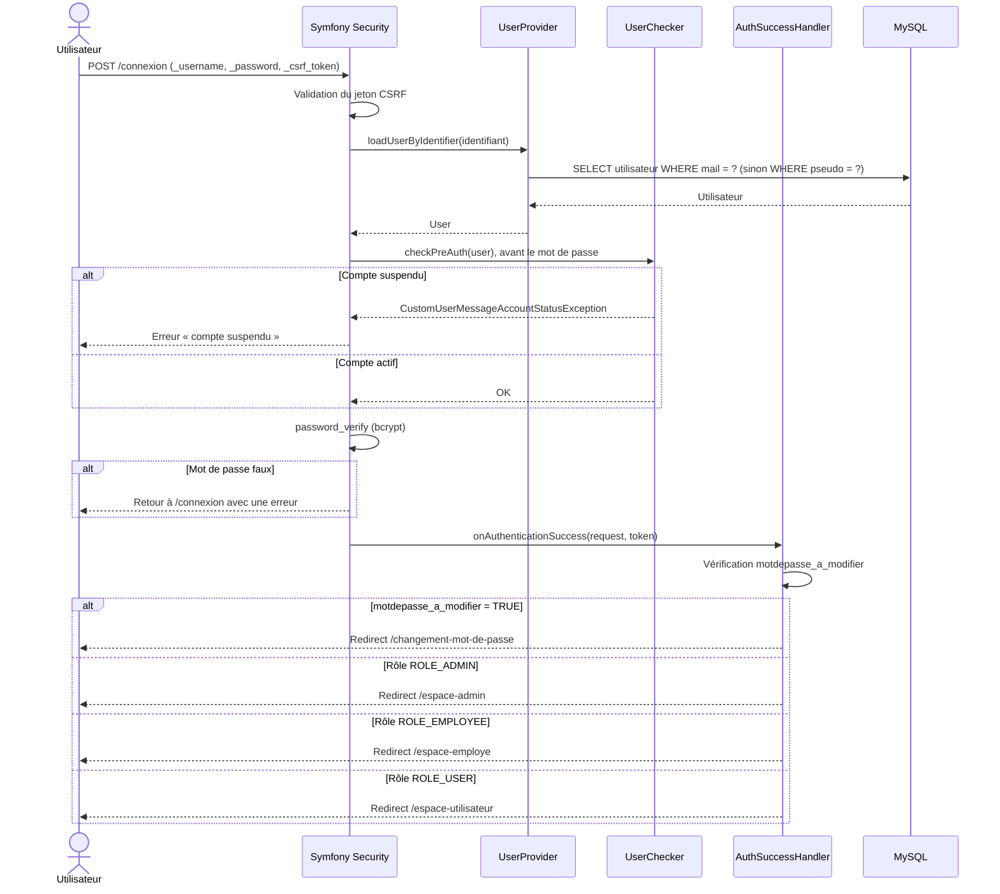
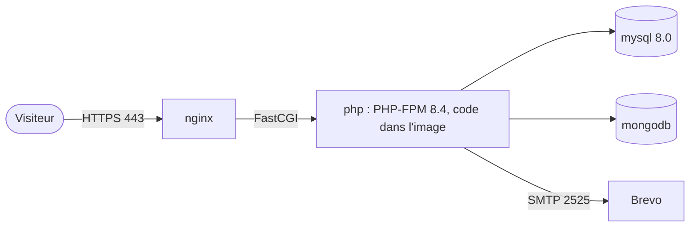

# Documentation technique — FantasyRealm Online

**Projet :** FantasyRealm Online — Application de gestion de personnages MMORPG\
**Client :** PixelVerse Studios\
**Version :** 1.1 — 18 novembre 2026 (relue et corrigée d'après le code et le serveur)

---

## 1. Réflexions technologiques initiales

### Choix du framework backend : Symfony 8 / PHP 8.4

Symfony a été retenu pour sa robustesse sur les applications métier complexes :
- **Sécurité intégrée** : CSRF, hachage de mots de passe (bcrypt), firewall configurable, hiérarchie de rôles
- **ORM Doctrine** : mapping objet-relationnel évitant le SQL manuel tout en permettant des requêtes optimisées
- **Système de templates Twig** : séparation claire logique / présentation
- **Mailer intégré** : gestion unifiée des emails (SMTP, null transport pour les tests)
- **Asset Mapper** : gestion des assets sans Node.js ni Webpack

### Choix de la base de données relationnelle : MySQL 8

MySQL a été préféré pour :
- **Données structurées** : entités fortement typées (utilisateurs, personnages, articles, commentaires)
- **Intégrité référentielle** : clés étrangères, contraintes CASCADE pour la suppression en cascade
- **Contraintes CHECK** : validation des valeurs de type "enum" directement en base

### Choix de la base NoSQL : MongoDB

MongoDB a été utilisé exclusivement pour les **logs d'activité** :
- Schéma flexible adapté aux événements hétérogènes
- Performances en écriture optimisées pour les logs
- Filtrage et pagination natifs
- Connexion via le driver PHP natif `ext-mongodb` + bibliothèque `mongodb/mongodb ^2.2`

### Choix de la conteneurisation : Docker + Docker Compose

- **Isolation** : chaque service dans son conteneur (PHP-FPM, Nginx, MySQL, MongoDB, Mailpit)
- **Reproductibilité** : même environnement en dev et en prod
- **Simplification du déploiement** : `docker compose up -d --build`

### Choix du frontend : Bootstrap 5 + JavaScript vanilla + Stimulus/Turbo

- **Bootstrap 5.3** via CDN : composants UI responsifs, thème dark natif
- **JavaScript vanilla** : validation formulaires, aperçu personnage canvas, étoiles interactives
- **Stimulus 3.2 + Turbo 7.3** : navigation SPA légère sans rechargement complet

---

## 2. Configuration de l'environnement

### Poste de développement

- **Windows 11**, projet dans `C:\xampp\htdocs\fantasy_realm`. XAMPP n'est
  pas utilisé pour faire tourner l'application : tout passe par Docker.
- **Docker Desktop** : PHP, Nginx, MySQL, MongoDB et Mailpit en conteneurs.
- **PhpStorm** (licence du GitHub Student Developer Pack).
- **Git**, dépôt hébergé sur **GitHub** ; workflow `main` / `dev` / une
  branche par modification (voir la documentation de gestion de projet).

### Environnement de développement Docker

```
docker compose up -d --build
docker compose exec php composer install
```

| Service | Image | Port hôte |
|---|---|---|
| Application | PHP 8.4-FPM + Nginx | http://localhost:8090 |
| MySQL | mysql:8.0 | localhost:3308 |
| MongoDB | mongo:latest | localhost:27019 |
| Mailpit (emails test) | axllent/mailpit | http://localhost:8026 |

Configuration : `.env` (versionné, valeurs par défaut sans secret) + `.env.local`
(surcharges locales, non versionné). En local, le code est monté en volume :
une modification est visible sans reconstruire l'image.

### Environnement de production

```
docker compose -f docker-compose.prod.yml --env-file .env.prod up -d --build
```

Différences par rapport au dev :
- Code source **copié dans l'image** (pas de volume de code)
- `APP_ENV=prod` → cache compilé, erreurs journalisées et jamais affichées (`php.ini-production`)
- MongoDB avec **authentification obligatoire**
- Ports MySQL/MongoDB **non exposés** à l'extérieur
- HTTPS via Let's Encrypt (Certbot)
- Assets compilés pendant la construction de l'image, puis copiés par
  `entrypoint.sh` dans un volume partagé avec Nginx
- Secrets dans `.env.prod`, sur le serveur seulement (exclu de l'image)

Le serveur et la procédure de mise en production sont décrits à la section 8.

---

## 3. Modèle Conceptuel de Données (MCD)



### Contraintes notables

- `utilisateur.pseudo` et `utilisateur.mail` : `UNIQUE` (le mail est enregistré en minuscules)
- `personnage.nom` : `UNIQUE`
- `commentaire.note` : entre 1 et 5 (CHECK en base) ; `commentaire.commentaire` : 500 caractères
- `utilisateur.suspendu` : booléen — compte bloqué si `TRUE`
- `utilisateur.motdepasse_a_modifier` : force le changement au prochain login
- `personnage.autorise` : tri-état — `NULL` = en attente, `TRUE` = approuvé, `FALSE` = rejeté (supprimé)
- `personnage.partage` : `TRUE` = visible dans la galerie publique
- `commentaire.statut` : `en_attente` | `approuve` | `refuse` (CHECK en base)
- `article.type` : `vetement` | `armure` | `accessoire` | `arme` (CHECK en base)
- `personnage.genre` : `Masculin` | `Féminin` | `Autre` (CHECK en base)

---

## 4. Diagramme de cas d'utilisation



---

## 5. Diagramme de séquence — Création et validation d'un personnage



Un employé ne peut ni approuver ni rejeter un personnage qui lui appartient.

---

## 6. Diagramme de séquence — Connexion et redirection selon le rôle



---

## 7. Architecture des services

| Service | Fichier | Responsabilité |
|---|---|---|
| `MailService` | `src/Service/MailService.php` | 5 types d'emails : contact, mot de passe oublié, personnage approuvé/rejeté, avis approuvé |
| `MongoLogService` | `src/Service/MongoLogService.php` | Écriture et lecture des logs dans MongoDB |
| `SvgPersonnageRenderer` | `src/Service/SvgPersonnageRenderer.php` | Portrait SVG côté serveur (équivalent PHP du dessin JavaScript), utilisé par la commande `app:generate-personnage-images` que `entrypoint.sh` lance au démarrage pour les personnages sans image |
| `PersonnageImageGenerator` | `src/Service/PersonnageImageGenerator.php` | Image PNG de secours (GD) quand le navigateur n'a pas envoyé d'image |

L'image normale d'un personnage est dessinée **dans le navigateur** (canvas),
puis envoyée en base64 avec le formulaire.

### Composants de sécurité

| Composant | Fichier | Rôle |
|---|---|---|
| `UserProvider` | `src/Security/UserProvider.php` | Chargement de l'utilisateur depuis MySQL, par mail ou par pseudo |
| `UserChecker` | `src/Security/UserChecker.php` | Refus de la connexion d'un compte suspendu (avant la vérification du mot de passe) |
| `AuthenticationSuccessHandler` | `src/Security/AuthenticationSuccessHandler.php` | Redirection post-login selon rôle + mot de passe à modifier |

---

## 8. Déploiement

Les commandes pas à pas (local et production) sont dans le **`README.md`**.
Cette section décrit l'installation réellement en service.

### Serveur

| Élément | Valeur |
|---|---|
| Hébergeur | DigitalOcean, centre de données d'Amsterdam |
| Machine | 1 processeur, 1 Go de RAM + 2 Go de mémoire d'appoint (swap) |
| Système | Debian 13, Docker 29, Docker Compose v5 |
| Domaine | `fantasyrealm.app` (HTTPS obligatoire pour ce domaine) |
| Accès | SSH par clé |

La mémoire d'appoint a été ajoutée en novembre 2026 : avec 1 Go seulement,
Linux avait arrêté MySQL faute de mémoire.

### Architecture de production



- **nginx** : HTTPS (certificat Let's Encrypt monté depuis `ssl/`), redirection
  80 → 443, fichiers statiques et assets compilés (volume `assets_data`).
- **php** : application Symfony en mode `prod` ; cache et logs dans le volume
  `var_data`.
- **mysql** : volume `mysql_data` ; au premier démarrage, `01-schema.sql` puis
  `02-data.sql` créent les tables et le jeu d'essai.
- **mongodb** : volume `mongo_data`, authentification obligatoire.
- Ports MySQL et MongoDB non exposés hors du réseau Docker.
- **Mails** : Brevo sur le port 2525, DigitalOcean bloquant 587 et 465.
- **Certificat** : renouvelé par `certbot.timer` ; trois scripts libèrent le
  port 80, copient le nouveau certificat et relancent Nginx.

### Procédure de mise à jour appliquée

1. Archive de la branche `main` (`git archive`) envoyée sur le serveur ; les
   fichiers modifiés sont comparés à la version en ligne avant d'être remplacés.
2. Sauvegarde de la base MySQL (`mysqldump`).
3. Image PHP en service conservée sous une étiquette, pour revenir en arrière.
4. Construction de la nouvelle image : le site reste en ligne.
5. Bascule de `php` et `nginx`, puis `cache:clear` (le cache vit dans un volume).
6. Contrôle automatique du contenu des pages ; en cas d'échec, retour à
   l'image conservée. Coupure constatée : 12 à 16 secondes.

### Fichiers de configuration

- `docker-compose.yml` — Environnement de développement
- `docker-compose.prod.yml` — Environnement de production
- `docker/php/Dockerfile` — Image PHP 8.4-FPM avec extensions (MongoDB avec SSL, GD…)
- `docker/php/entrypoint.sh` — Démarrage : copie des assets compilés pour Nginx, génération des images manquantes
- `docker/nginx/default.conf` — Nginx développement
- `docker/nginx/prod.conf` — Nginx production (HTTPS, TLS 1.2/1.3)
- `.dockerignore` — Exclut de l'image `.env.prod` et `ssl/`
- `database/01-schema.sql` — Schéma complet de la base de données
- `database/02-data.sql` — Données initiales (rôles, comptes, articles)
